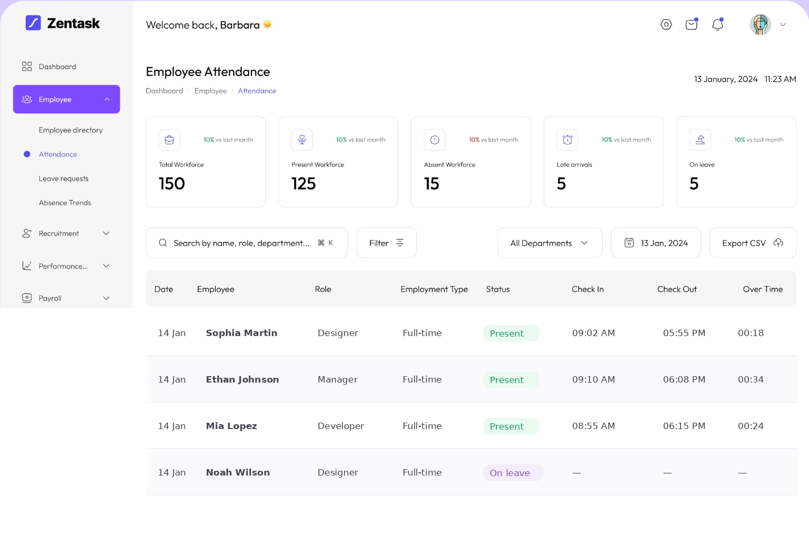

<div align="center">


# Zentask — Responsive Single-Screen Homepage

**A polished, animated SaaS homepage built with pure HTML, CSS & JavaScript.**
No frameworks. No build step. Just open it and it works.

<br />


<br />



</div>

<br />

## 📖 About the Project

**Zentask** is a responsive, single-screen homepage for a task-management product. It recreates a modern SaaS landing design using only **HTML5, CSS3 and vanilla JavaScript**, with a purple gradient-grid hero, glowing particles, smooth animations and an interactive product walkthrough.

The goal of this project was to practice turning a visual design into clean, accessible, production-style front-end code, without relying on any framework or bundler.

> **Note:** This is a static UI project, not a working task-management platform. Login, sign-up, contact and billing flows are demo-only.

<br />

## ✨ Features

| | Feature | Details |
|---|---|---|
| 🎨 | **Striking hero section** | Gradient grid background, glowing particles, image-based logo and dashboard preview |
| 📱 | **Fully responsive** | Adaptive layout with a desktop navigation bar and a mobile menu |
| 🧭 | **Accessible dropdown menus** | Keyboard-friendly navigation with clear focus states |
| 💬 | **Interactive demo dialogs** | Login, Start Free, Pricing, Blogs, FAQs, Features, About and Contact |
| 🪄 | **Product walkthrough** | Interactive three-step guide that explains how the product works |
| ✅ | **Form validation** | Basic HTML form validation on the demo forms |
| 🌙 | **Reduced-motion support** | Respects the user's `prefers-reduced-motion` setting |
| 🔍 | **SEO-ready** | Meta tags, Open Graph / Twitter cards, Schema.org JSON-LD, `robots.txt`, favicon and web manifest |

<br />

## 🛠️ Tech Stack

<p>
  <a href="https://developer.mozilla.org/en-US/docs/Web/HTML"></a>
  <a href="https://developer.mozilla.org/en-US/docs/Web/CSS"></a>
  <a href="https://developer.mozilla.org/en-US/docs/Web/JavaScript"></a>
  <a href="https://git-scm.com/"></a>
  <a href="https://github.com/"></a>
</p>

| Category | Tools |
|---|---|
| **Markup** | Semantic HTML5 |
| **Styling** | CSS3 (custom properties, Flexbox, Grid, animations) |
| **Logic** | Vanilla JavaScript (ES6+) |
| **Icons** | [Ionicons](https://ionic.io/ionicons) |
| **Fonts** | [Google Fonts](https://fonts.google.com/) with local fallback fonts |

<br />

## 🚀 Getting Started

No installation or build step is needed.

**1. Clone the repository**

```bash
git clone https://github.com/NSniha/task-homepage.git
cd task-homepage
```

**2. Run it**

Simply open `index.html` in your browser, **or** start a local server:

```bash
python -m http.server 5500
```

**3. Visit**

```
http://localhost:5500
```

<br />

## 🖼️ Customize the Images

The project ships with working images, so it looks complete right away. To use your own, replace these three:

| Image | Path | How to change |
|---|---|---|
| **Background** | `assets/images/hero-background.svg` | Add your image to `assets/images`, then update `--hero-background-url` in `styles.css`, e.g. `url("assets/images/my-background.webp")` |
| **Dashboard** | `assets/images/dashboard-preview.webp` | Replace the file, or update the `src` of `` in `index.html` |
| **Logo** | `assets/images/zentask-logo.svg` | Replace the SVG, or update the header `` path |

> 💡 **Tip:** For production, use optimized `.webp` / `.avif` images and add `width` and `height` attributes in the HTML to avoid layout shift.

<br />

## 📂 Project Structure

```
task-homepage/
├── index.html
├── styles.css
├── script.js
├── README.md
├── robots.txt
├── site.webmanifest
└── assets/
    ├── icons/
    │   └── favicon.svg
    └── images/
        ├── hero-background.svg
        ├── zentask-logo.svg
        ├── dashboard-preview.webp
        ├── og-preview.jpg
        └── apple-touch-icon.png
```

<br />

## ♿ Accessibility & SEO

**Accessibility**

- Semantic landmarks and a clear heading structure
- Descriptive `alt` text for images
- Accessible modal dialogs with keyboard support
- Visible keyboard focus states
- Reduced-motion support for animations

**SEO**

- Page title and meta descriptions
- `robots` meta tag and `robots.txt`
- Open Graph and Twitter card tags
- Schema.org JSON-LD structured data
- Favicon and web manifest

<br />

## 📦 Production Notes

Before publishing, keep these in mind:

- **Set your real domain** in a canonical link, and change `og:image` and `twitter:image` to absolute HTTPS URLs.
- **Generate a sitemap** for your published domain if needed.
- **Check `site.webmanifest`**: it uses root-relative paths, so adjust them if you deploy under a subdirectory.
- **External resources:** Ionicons and Google Fonts load from CDNs, so an internet connection is needed on first load. The UI stays usable with local fallback fonts.
- **Add a backend before collecting real data.** Login, registration, contact forms and billing are demo-only.

<br />

## 👩‍💻 Author

**Nobonita Saha Niha** — Front-End Developer

[](https://github.com/NSniha)
[](https://www.linkedin.com/in/nobonita-saha-niha-04b501214/)

<br />

<div align="center">

If you like this project, please consider giving it a ⭐

</div>
